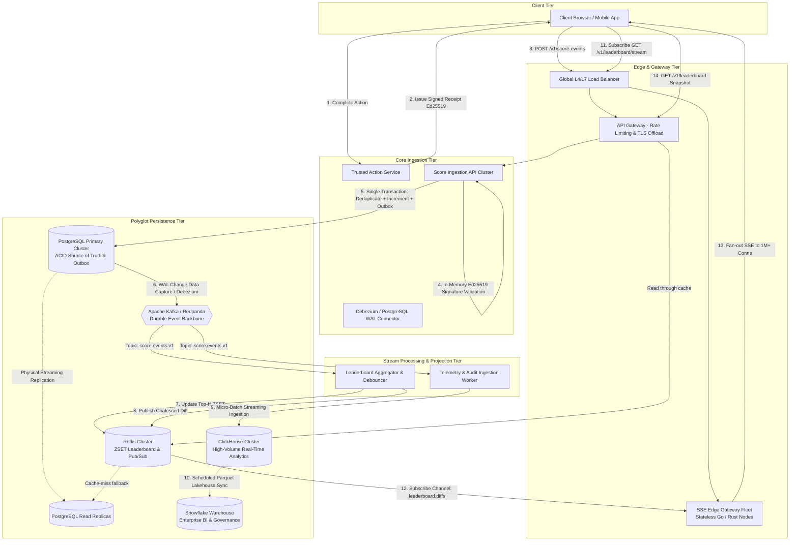
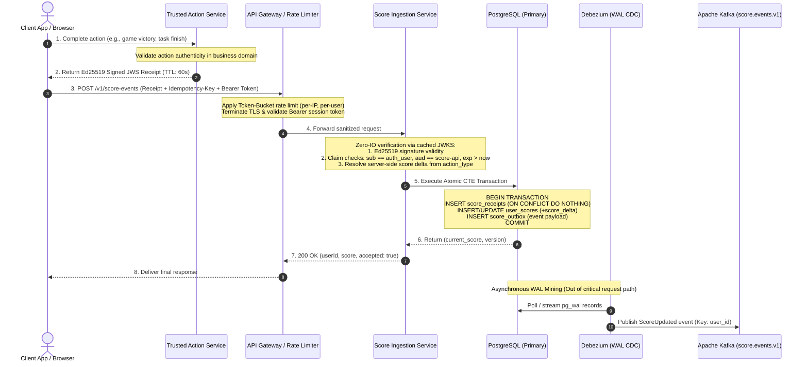
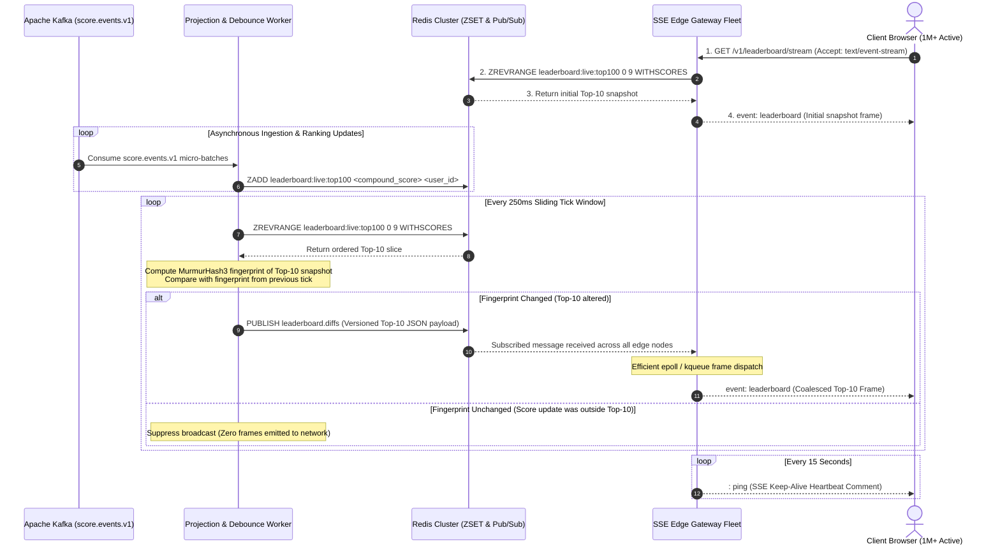
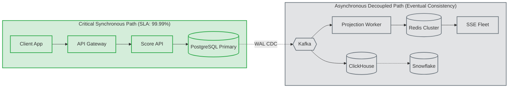
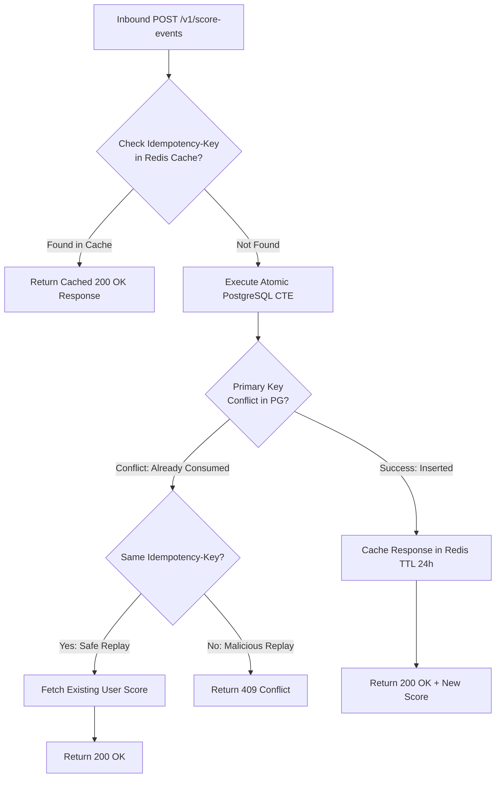
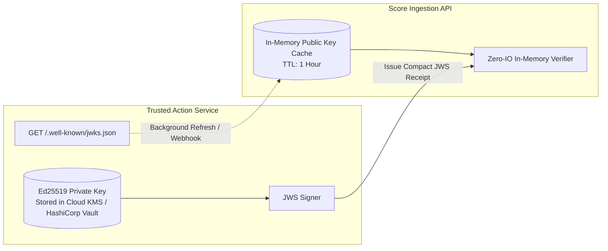
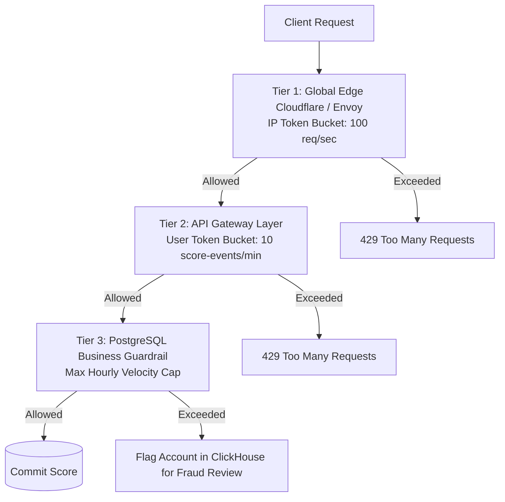
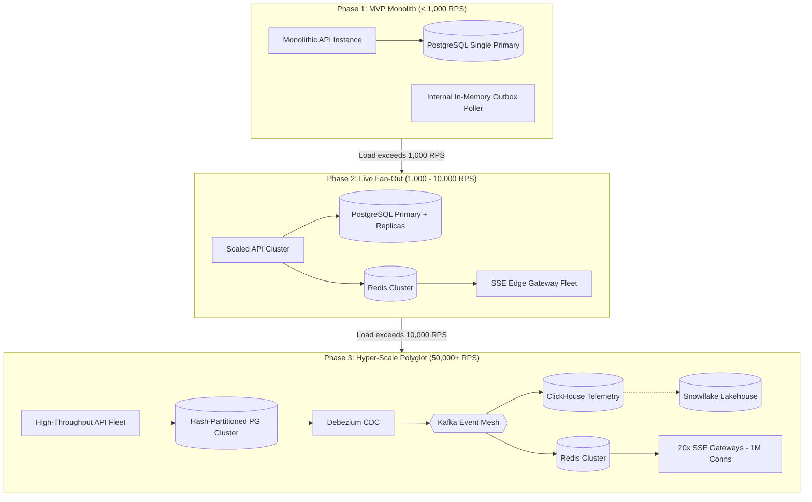

# Live Scoreboard API Module — High-Scale System Architecture

## Table of Contents
1. [Executive Summary & Problem Scope](#1-executive-summary--problem-scope)
   - [1.1 Purpose](#11-purpose)
   - [1.2 Requirements & Zero-Trust Security Boundary](#12-requirements--zero-trust-security-boundary)
2. [Workload Profiling & Back-of-the-Envelope Capacity Planning](#2-workload-profiling--back-of-the-envelope-capacity-planning)
   - [2.1 The "Broadcast Amplification" Problem & Mathematical Resolution](#21-the-broadcast-amplification-problem--mathematical-resolution)
   - [2.2 Hardware Sizing, Memory Footprint & Resource Planning](#22-hardware-sizing-memory-footprint--resource-planning)
3. [High-Scale End-to-End System Architecture](#3-high-scale-end-to-end-system-architecture)
   - [3.1 High-Concurrency Score Ingestion Sequence](#31-high-concurrency-score-ingestion-sequence)
   - [3.2 End-to-End Sequence Diagram: Action Verification & Score Ingestion](#32-end-to-end-sequence-diagram-action-verification--score-ingestion)
   - [3.3 End-to-End Sequence Diagram: Live Leaderboard Update & Coalesced SSE Broadcast](#33-end-to-end-sequence-diagram-live-leaderboard-update--coalesced-sse-broadcast)
   - [3.4 State Reconciliation & Failure Domain Isolation](#34-state-reconciliation--failure-domain-isolation)
4. [Storage Topology & Polyglot Architectural Rationale](#4-storage-topology--polyglot-architectural-rationale)
   - [4.1 Storage Responsibility & Decision Matrix](#41-storage-responsibility--decision-matrix)
   - [4.2 PostgreSQL: The Immutable Financial-Grade Core](#42-postgresql-the-immutable-financial-grade-core)
   - [4.3 Redis Cluster: In-Memory Leaderboard & Fan-Out Projection](#43-redis-cluster-in-memory-leaderboard--fan-out-projection)
   - [4.4 Apache Kafka / Redpanda: The Asynchronous Event Mesh](#44-apache-kafka--redpanda-the-asynchronous-event-mesh)
   - [4.5 ClickHouse: High-Volume Operational Analytics & Abuse Detection](#45-clickhouse-high-volume-operational-analytics--abuse-detection)
   - [4.6 Snowflake: Enterprise Lakehouse & Long-Term BI](#46-snowflake-enterprise-lakehouse--long-term-bi)
5. [API & Interface Technical Specifications](#5-api--interface-technical-specifications)
   - [5.1 Protocol Standards & Global Security Headers](#51-protocol-standards--global-security-headers)
   - [5.2 Score Ingestion Endpoint: `POST /v1/score-events`](#52-score-ingestion-endpoint-post-v1score-events)
   - [5.3 Leaderboard Snapshot Endpoint: `GET /v1/leaderboard`](#53-leaderboard-snapshot-endpoint-get-v1leaderboard)
   - [5.4 Live Leaderboard Stream: `GET /v1/leaderboard/stream`](#54-live-leaderboard-stream-get-v1leaderboardstream)
   - [5.5 Administrative Score Adjustment & Reconciliation: `POST /v1/admin/scores/adjust`](#55-administrative-score-adjustment--reconciliation-post-v1adminscoresadjust)
   - [5.6 Comprehensive Standardized Error Catalog (RFC 7807)](#56-comprehensive-standardized-error-catalog-rfc-7807)
6. [Concurrency Control, Idempotency & Data Consistency](#6-concurrency-control-idempotency--data-consistency)
   - [6.1 Atomic Multi-Step CTE Ingestion & Race Condition Mitigation](#61-atomic-multi-step-cte-ingestion--race-condition-mitigation)
   - [6.2 Distributed Idempotency Protocol & Sliding Window Retention](#62-distributed-idempotency-protocol--sliding-window-retention)
   - [6.3 The Dual-Write Anti-Pattern & Transactional Outbox Pattern with CDC](#63-the-dual-write-anti-pattern--transactional-outbox-pattern-with-cdc)
   - [6.4 Cache Invalidation & Eventual Consistency Guarantees](#64-cache-invalidation--eventual-consistency-guarantees)
7. [Security Architecture & Threat Modeling (STRIDE)](#7-security-architecture--threat-modeling-stride)
   - [7.1 STRIDE Threat Analysis Matrix](#71-stride-threat-analysis-matrix)
   - [7.2 Cryptographic Action Verification & Key Management](#72-cryptographic-action-verification--key-management)
   - [7.3 Multi-Tier Rate Limiting Architecture](#73-multi-tier-rate-limiting-architecture)
   - [7.4 Anti-Sybil & Anti-Abuse Heuristics](#74-anti-sybil--anti-abuse-heuristics)
8. [High-Scale Broadcast & Edge Streaming Engine (1M+ Connections)](#8-high-scale-broadcast--edge-streaming-engine-1m-connections)
   - [8.1 Comparative Transport Evaluation Matrix](#81-comparative-transport-evaluation-matrix)
   - [8.2 Sliding-Window Debounce & Coalescing Engine](#82-sliding-window-debounce--coalescing-engine)
   - [8.3 Gateway Memory Management & Socket Kernel Tuning (OS sysctl)](#83-gateway-memory-management--socket-kernel-tuning-os-sysctl)
   - [8.4 Graceful Degradation & Network Backpressure Control](#84-graceful-degradation--network-backpressure-control)
9. [Architectural Decision Records (ADRs) & Trade-Off Analysis](#9-architectural-decision-records-adrs--trade-off-analysis)
   - [9.1 ADR-001: Server-Sent Events (SSE) vs WebSockets for Live Scoreboards](#91-adr-001-server-sent-events-sse-vs-websockets-for-live-scoreboards)
   - [9.2 ADR-002: Log-Based CDC (Debezium) vs Application-Level Dual-Writes](#92-adr-002-log-based-cdc-debezium-vs-application-level-dual-writes)
   - [9.3 ADR-003: Redis ZSET Compound Floating-Point Scoring vs PostgreSQL In-Memory Scan](#93-adr-003-redis-zset-compound-floating-point-scoring-vs-postgresql-in-memory-scan)
   - [9.4 ADR-004: In-Memory Asymmetric JWS Receipt Verification vs Synchronous RPC Validation](#94-adr-004-in-memory-asymmetric-jws-receipt-verification-vs-synchronous-rpc-validation)
   - [9.5 ADR-005: Multi-Stage Tiered Storage (PostgreSQL -> ClickHouse -> Snowflake)](#95-adr-005-multi-stage-tiered-storage-postgresql---clickhouse---snowflake)
10. [Progressive Rollout & Phased Migration Strategy](#10-progressive-rollout--phased-migration-strategy)
    - [10.1 Phase 1: MVP / Low-Scale Monolith (< 1,000 RPS)](#101-phase-1-mvp--low-scale-monolith--1000-rps)
    - [10.2 Phase 2: High Read Scale & Live Fan-Out (1,000 - 10,000 RPS, Up to 100k SSE)](#102-phase-2-high-read-scale--live-fan-out-1000---10000-rps-up-to-100k-sse)
    - [10.3 Phase 3: Hyper-Scale Polyglot Infrastructure (50,000+ RPS, 1M+ SSE)](#103-phase-3-hyper-scale-polyglot-infrastructure-50000-rps-1m-sse)
    - [10.4 Quantitative Migration Triggers](#104-quantitative-migration-triggers)
11. [Observability, Telemetry & Disaster Recovery (SLOs & Runbooks)](#11-observability-telemetry--disaster-recovery-slos--runbooks)
    - [11.1 Service Level Objectives (SLOs) & Error Budgets](#111-service-level-objectives-slos--error-budgets)
    - [11.2 Distributed Tracing & W3C Trace Context](#112-distributed-tracing--w3c-trace-context)
    - [11.3 Key Operational Metrics & Alerting Thresholds](#113-key-operational-metrics--alerting-thresholds)
    - [11.4 Disaster Recovery & Runbooks (PITR & Redis Rebuild)](#114-disaster-recovery--runbooks-pitr--redis-rebuild)
12. [Verification & Acceptance Criteria](#12-verification--acceptance-criteria)
    - [12.1 Automated Acceptance Testing Matrix](#121-automated-acceptance-testing-matrix)
    - [12.2 Chaos Engineering & Load Testing Test Cases](#122-chaos-engineering--load-testing-test-cases)
13. [Implementation Roadmap & Engineering Decision Guide](#13-implementation-roadmap--engineering-decision-guide)
    - [13.1 Developer Implementation Checklist](#131-developer-implementation-checklist)
    - [13.2 Clarifications & Decisions for the Implementation Team](#132-clarifications--decisions-for-the-implementation-team)
    - [13.3 Summary of Architectural Guarantees](#133-summary-of-architectural-guarantees)

---

## 1. Executive Summary & Problem Scope

### 1.1 Purpose
This specification defines the production system architecture for an enterprise-grade, high-throughput, low-latency Scoreboard Module capable of:
1. Ingesting cryptographically verified, tamper-resistant score updates under peak workloads ($50,000+$ write requests/sec).
2. Serving deterministic top-10 leaderboard queries with sub-5ms p99 latency ($20,000+$ read requests/sec).
3. Pushing live leaderboard updates in real-time to over $1,000,000$ concurrent connected clients via Server-Sent Events (SSE) without saturating egress networks or database connection pools.
4. Orchestrating a multi-database polyglot storage platform (**PostgreSQL**, **Redis**, **ClickHouse**, **Snowflake**) with rigorous consistency guarantees, strict failure domain isolation, and zero dual-write anomalies.

### 1.2 Requirements & Zero-Trust Security Boundary
- **Display Invariant:** Connected clients receive the 10 highest-scoring users in strict deterministic order (Score DESC, User ID ASC).
- **Live Stream Updates:** Clients receive push updates if and only if the ordered top-10 leaderboard changes.
- **Untrusted Client Boundary:** The client/browser is fundamentally untrusted. It must never supply arbitrary score values, deltas, or self-asserted completion statuses.
- **Verification Decoupling:** Action validation (e.g., gameplay victory, task completion, purchase verification) is performed outside this module by a configured **Trusted Action Service**.
- **Cryptographic Receipts:** Score changes require an authenticated user session and an unconsumed, cryptographically signed, short-lived completion receipt issued by the Trusted Action Service.

---

## 2. Workload Profiling & Back-of-the-Envelope Capacity Planning

To guide engineering decisions, hardware sizing, and architectural trade-offs, the system is designed against the following hyper-scale workload targets:

| Dimension | Target Specification (Peak) | Architectural Implication |
| :--- | :--- | :--- |
| **Write Throughput** | $50,000$ score events/sec | Requires atomic lock-free ingestion, hash partitioning, and zero synchronous downstream writes. |
| **Read Throughput** | $20,000$ snapshot queries/sec | Demands in-memory caching (Redis) with singleflight stampede protection and DB replica fallback. |
| **Concurrent Viewers** | $1,000,000$ active SSE streams | Demands a stateless, compiled Edge Gateway fleet (Go/Rust/Envoy) decoupled from application servers. |
| **Top-10 Volatility** | Up to $5,000$ score bumps/sec | Naive push creates a $5\text{ Billion frames/sec}$ broadcast storm; requires sliding-window coalescing. |
| **Broadcast Latency** | $\le 500\text{ ms}$ (p99) | End-to-end propagation from DB transaction commit to client screen. |
| **Idempotency Window** | $7\text{ days}$ deduplication | Partitioned unique index on receipt UUID (`jti`) with sliding-window retention. |

### 2.1 The "Broadcast Amplification" Problem & Mathematical Resolution
In a naive architecture where every committed score update immediately broadcasts a push message to all connected clients:
$$\text{Outgoing Frames/sec} = 5,000\text{ score updates/sec} \times 1,000,000\text{ clients} = 5,000,000,000\text{ frames/sec}$$
At an average JSON frame size of $200\text{ bytes}$:
$$\text{Egress Bandwidth} = 5 \times 10^9 \times 200\text{ bytes} = 1,000,000,000,000\text{ bytes/sec} = 1.0\text{ TB/sec } (8.0\text{ Tbps})$$
This naive broadcast model would instantly exhaust infrastructure bandwidth and trigger massive TCP buffer drops.

**Architectural Solution (Debounce & Coalescing Engine):**
1. Score updates are decoupled from the broadcast path via an asynchronous event stream.
2. A specialized Projection Worker maintains the top-10 projection in-memory and executes a **250ms sliding tick window**.
3. During each tick, the worker computes a cryptographic hash (e.g., MurmurHash3 or SHA-256) of the ordered top-10 snapshot.
4. If the snapshot fingerprint is identical to the prior tick, **zero frames are emitted**.
5. Under maximum volatility, output is strictly throttled to at most $4\text{ frames/sec}$ per client:
   $$\text{Maximum Peak Egress} = 4\text{ frames/sec} \times 1,000,000\text{ clients} \times 200\text{ bytes} = 800\text{ MB/sec } (6.4\text{ Gbps})$$
   This manageable $6.4\text{ Gbps}$ egress is distributed across a horizontally scaled edge gateway fleet of 20 nodes ($\sim 320\text{ Mbps}$ per node).

### 2.2 Hardware Sizing, Memory Footprint & Resource Planning

To provide concrete procurement and infrastructure sizing targets, the resource calculations for storage, compute, memory, and network are derived below:

#### 1. Ingestion Throughput & Storage Growth (PostgreSQL)
- **Peak Write Volume:** $50,000\text{ req/sec}$. Sustained 24h average: $10,000\text{ req/sec}$.
- **Daily Event Count:** $10,000 \times 86,400\text{ s} \approx 864,000,000\text{ records/day}$.
- **Row Footprint (`score_receipts`):** $\sim 200\text{ bytes/row}$ (UUID + IDs + Timestamps + B-tree overhead).
  $$\text{Daily Ingestion Volume} = 864 \times 10^6 \times 200\text{ bytes} \approx 172.8\text{ GB/day}$$
- **7-Day Retention Window:**
  $$\text{Hot Working Storage} = 7 \times 172.8\text{ GB} \approx 1.21\text{ TB}$$
  Enforced via **PostgreSQL Table Partitioning by Day/Hash**: Dropping expired partitions takes $\mathcal{O}(1)$ time (`DROP TABLE partition_day_N`) without triggering VACUUM bloat or transaction log thrashing.

#### 2. Network Ingress & Egress Bandwidth
- **HTTP Ingress (POST /v1/score-events):**
  $$\text{Peak Ingress} = 50,000\text{ req/sec} \times 600\text{ bytes/req} \approx 30.0\text{ MB/sec } (240\text{ Mbps})$$
- **HTTP Egress (GET /v1/leaderboard):**
  $$\text{Peak Snapshot Egress} = 20,000\text{ req/sec} \times 400\text{ bytes/resp} \approx 8.0\text{ MB/sec } (64\text{ Mbps})$$
- **Streaming Egress (SSE Fleet to 1M Viewers):**
  $$\text{Coalesced Peak Egress} = 6.4\text{ Gbps} \text{ (distributed across 20 nodes } \approx 320\text{ Mbps/node)}$$

#### 3. Edge Gateway Concurrency & Memory Budget
- **Target Concurrent Connections:** $1,000,000$ active SSE streams.
- **Node Allocation:** 20 Stateless Edge Instances (Go / Rust / Envoy epoll architecture).
- **Concurrency per Node:** $50,000\text{ TCP sockets/node}$.
- **Memory Footprint per Socket:**
  - Linux Kernel TCP buffer (`tcp_rmem` / `tcp_wmem` tuned to 4KB): $\sim 8\text{ KB}$.
  - User-space connection buffer & subscriber state: $\sim 8\text{ KB}$.
  - Total Memory per connection: $\approx 16\text{ KB}$.
  $$\text{Active Socket RAM per Node} = 50,000 \times 16\text{ KB} \approx 800\text{ MB}$$
  Deploying nodes with **16 vCPU and 32 GB RAM** ensures $<10\%$ memory utilization, leaving ample headroom for kernel page tables, TLS termination buffers, and zero-copy packet queues.

#### 4. Analytics Columnar Footprint (ClickHouse)
- Raw uncompressed data: $\sim 172.8\text{ GB/day}$.
- ClickHouse columnar compression (ZSTD / Gorilla, average 5:1 ratio):
  $$\text{Compressed Daily Telemetry} \approx 34.5\text{ GB/day}$$
- 90-day hot operational analytics window requires $\approx 3.1\text{ TB}$ of NVMe SSD storage, easily handled by a 3-node ClickHouse cluster.

---

## 3. High-Scale End-to-End System Architecture



### 3.1 High-Concurrency Score Ingestion Sequence
1. **User Authentication:** User completes an authenticated action on the platform.
2. **Cryptographic Proof Generation:** The Trusted Action Service generates a short-lived ($\le 60\text{s}$), cryptographically signed receipt containing the user ID, action type, and unique UUID (`jti`).
3. **Receipt Submission:** Client submits the receipt to `POST /v1/score-events` along with an idempotency key.
4. **Zero-IO Auth Verification:** The Score API verifies the cryptographic signature in-memory using local cached JWKS public keys without issuing any remote network calls.
5. **Atomic ACID Mutation:** In a single PostgreSQL transaction:
   - Verifies the receipt UUID (`jti`) is unconsumed.
   - Atomically increments the user's total score.
   - Appends an audit event to the `score_outbox` table.
6. **Synchronous Acknowledgement:** The transaction commits and returns the updated score directly to the caller.
7. **Asynchronous CDC Fan-Out:** Debezium captures the outbox insertion from the PostgreSQL WAL log and streams it to Kafka.
8. **Decoupled Projection & Analytics:**
   - The Projection Worker updates the Redis Sorted Set (`ZSET`) and publishes top-10 changes if the 250ms debounced window detects an altered ranking.
   - The Analytics Worker streams audit records to ClickHouse for anomaly detection and fraud telemetry.

### 3.2 End-to-End Sequence Diagram: Action Verification & Score Ingestion



### 3.3 End-to-End Sequence Diagram: Live Leaderboard Update & Coalesced SSE Broadcast



### 3.4 State Reconciliation & Failure Domain Isolation

In a distributed polyglot platform, failure modes must be explicitly decoupled to guarantee that a downstream component outage does not cause cascading service failure on the primary ingestion path.



#### Failure Isolation Matrix
1. **Redis Outage / Eviction:**
   - Score ingestion (`POST /v1/score-events`) is **100% unaffected**.
   - Leaderboard snapshot reads (`GET /v1/leaderboard`) fall back gracefully to PostgreSQL Read Replicas protected by singleflight mutexes.
   - SSE edge fleet sustains open streams with the last known valid snapshot until Redis recovers.
   - Recovery is fully automated via an idempotent rebuild script replaying the top-100 users directly from PostgreSQL.
2. **Kafka / Debezium Interruption:**
   - Score ingestion commits normally to PostgreSQL. The `score_outbox` table buffers events durable on disk.
   - Live stream broadcasts pause; once the Kafka connector resumes, it drains the outbox in strict chronological sequence without data loss.
3. **ClickHouse / Snowflake Pipeline Downtime:**
   - Ingestion and live leaderboards operate with zero latency penalty.
   - Kafka topics retain 7 days of message logs (`retention.ms = 604800000`), allowing analytical ingestion to resume and backfill seamlessly.
4. **Self-Healing Reconciliation Engine:**
   - A scheduled hourly cron job reads the Top-100 ranks from PostgreSQL (`SELECT user_id, current_score FROM user_scores ORDER BY current_score DESC, user_id ASC LIMIT 100`) and compares MurmurHash3 fingerprints with Redis.
   - In the event of network partition drift, the job executes an atomic `ZADD` transaction to restore 100% precision without restarting servers.

---

## 4. Storage Topology & Polyglot Architectural Rationale

A common failure mode in large-scale system planning is attempting to use a single database engine to handle transactional ACID updates, high-frequency read caching, real-time audit ingestion, and analytical business intelligence. This architecture enforces a strict separation of concerns across specialized storage tiers.

### 4.1 Storage Responsibility & Decision Matrix

| Dimension | **PostgreSQL (v16+)** | **Redis Cluster (v7+)** | **ClickHouse** | **Snowflake** |
| :--- | :--- | :--- | :--- | :--- |
| **System Role** | Authoritative System of Record | Transient Cache & Pub/Sub Fan-out | Operational Analytics & Fraud Telemetry | Enterprise Data Warehouse & Governance |
| **Consistency Model** | Strict Serializability / Read Committed | Eventual (Rebuildable from PG) | Eventual Consistency (Asynchronous Append) | ACID Analytical Consistency |
| **Latency Profile** | Sub-10ms writes, Sub-2ms indexed reads | Sub-1ms in-memory reads/writes | Sub-50ms analytical aggregate queries | Multi-second / minute batch queries |
| **Throughput Target** | $50,000$ TPS (via Hash Partitioning + Pool) | $500,000+$ ops/sec | $500,000+$ rows/sec append | Batch bulk micro-loads |
| **Failure Tolerance** | Multi-AZ sync standby, 0 data loss (RPO=0) | Non-authoritative: Can flush & rebuild | Loss of recent seconds tolerable | Non-critical to operational uptime |
| **Anti-Pattern** | Analytical scans over millions of rows | Using as durable storage for user balances | Serving individual row lookups for live API | Direct synchronous dependency in API request |

---

### 4.2 PostgreSQL: The Immutable Financial-Grade Core

PostgreSQL maintains authoritative ownership of user accounts, total score states, consumed idempotency receipts, and the transactional outbox.

#### Schema Design & Partitioning Strategy
To prevent single-table lock contention and B-tree index bloat at $50,000$ writes/sec, `user_scores` and `score_receipts` are horizontally hash-partitioned on `user_id` across 64 physical partitions:

```sql
-- Hash-partitioned authoritative score state
CREATE TABLE user_scores (
    user_id          VARCHAR(64) NOT NULL,
    current_score    BIGINT NOT NULL DEFAULT 0 CHECK (current_score >= 0),
    version          BIGINT NOT NULL DEFAULT 1,
    created_at       TIMESTAMPTZ NOT NULL DEFAULT NOW(),
    updated_at       TIMESTAMPTZ NOT NULL DEFAULT NOW(),
    PRIMARY KEY (user_id)
) PARTITION BY HASH (user_id);

-- Hash-partitioned receipt consumption table for replay prevention
CREATE TABLE score_receipts (
    receipt_jti      UUID NOT NULL,
    user_id          VARCHAR(64) NOT NULL,
    action_type      VARCHAR(32) NOT NULL,
    score_delta      INTEGER NOT NULL,
    idempotency_key  VARCHAR(128) NOT NULL,
    consumed_at      TIMESTAMPTZ NOT NULL DEFAULT NOW(),
    PRIMARY KEY (receipt_jti, user_id)
) PARTITION BY HASH (user_id);

CREATE UNIQUE INDEX idx_receipts_idempotency 
ON score_receipts (user_id, idempotency_key);

-- Transactional Outbox for reliable event propagation (Unpartitioned, append-only)
CREATE TABLE score_outbox (
    event_id         UUID PRIMARY KEY DEFAULT gen_random_uuid(),
    aggregate_id     VARCHAR(64) NOT NULL, -- user_id
    event_type       VARCHAR(64) NOT NULL,
    payload          JSONB NOT NULL,
    created_at       TIMESTAMPTZ NOT NULL DEFAULT NOW()
);
CREATE INDEX idx_score_outbox_created_at ON score_outbox (created_at);
```

#### High-Throughput Atomic Ingestion Query
The score increment, receipt recording, and outbox insertion occur within a single database transaction. Lock contention is bounded strictly to the specific `user_id` row without lock escalation:

```sql
WITH consumed_receipt AS (
    -- Step 1: Atomic deduplication via receipt primary key
    INSERT INTO score_receipts (receipt_jti, user_id, action_type, score_delta, idempotency_key)
    VALUES ($1, $2, $3, $4, $5)
    ON CONFLICT (receipt_jti, user_id) DO NOTHING
    RETURNING receipt_jti, score_delta
),
updated_score AS (
    -- Step 2: Atomic score update; skips if receipt was already consumed
    INSERT INTO user_scores (user_id, current_score, version, updated_at)
    SELECT $2, $4, 1, NOW()
    WHERE EXISTS (SELECT 1 FROM consumed_receipt)
    ON CONFLICT (user_id) DO UPDATE
    SET current_score = user_scores.current_score + EXCLUDED.current_score,
        version       = user_scores.version + 1,
        updated_at    = NOW()
    RETURNING current_score, version
),
inserted_outbox AS (
    -- Step 3: Transactional Outbox Event Creation
    INSERT INTO score_outbox (aggregate_id, event_type, payload)
    SELECT $2, 'ScoreUpdated', jsonb_build_object(
        'userId', $2,
        'delta', $4,
        'newScore', u.current_score,
        'version', u.version,
        'receiptJti', $1,
        'timestamp', EXTRACT(EPOCH FROM NOW())
    )
    FROM updated_score u
)
SELECT current_score, version FROM updated_score;
```
*Engineering Guarantee:* If `score_receipts` conflicts, `consumed_receipt` returns zero rows, causing `updated_score` and `inserted_outbox` to execute as no-ops. Concurrent replays return the pre-existing state without double-awarding points.

#### Connection Management with PgBouncer
To support $50,000$ RPS without exhausting PostgreSQL backend processes:
- PostgreSQL is paired with **PgBouncer** running in **Transaction Pooling Mode**.
- Backend pool size is capped at $N = 2 \times \text{CPU Cores} + \text{Disk Spindle Count}$ ($\sim 128-256$ active server connections), preventing thread-context switching and cache thrashing.

---

### 4.3 Redis Cluster: In-Memory Leaderboard & Fan-Out Projection

Redis serves as a secondary, rebuildable read projection and pub/sub backbone. It does **not** act as the authoritative source of truth.

#### 1. Sorted Set (`ZSET`) Modeling & Precision Limitations
Redis `ZSET` stores scores using **IEEE 754 64-bit floating point numbers** (giving 53 bits of integer precision, safely supporting scores up to $9,007,199,254,740,991$).

**Deterministic Tie-Breaking via Compound Scoring:**
In high-volume gaming or contest environments, ties are common. To prevent nondeterministic rank flipping between server nodes:
$$\text{Compound Score} = \text{Actual Score} + \left(1 - \frac{\text{Timestamp}_{\text{epoch}}}{10^{12}}\right)$$
Users who reached the score earlier receive a minute fractional fraction higher, guaranteeing deterministic ordering without secondary database lookups:

```
ZADD leaderboard:live:top100 <compound_score> <user_id>
```

#### 2. Cache Stampede Mitigation: Singleflight & Probabilistic Expiration
If the Redis leaderboard key expires or is flushed, thousands of concurrent `GET /v1/leaderboard` requests would pound PostgreSQL replicas simultaneously.
- **Probabilistic Early Expiration (XFetch algorithm)** or **In-Memory Go Singleflight / Mutex Locking** ensures that exactly **one** backend instance executes the fallback query against the PostgreSQL read replica, while all other concurrent requests wait on that single execution promise.

---

### 4.4 Apache Kafka / Redpanda: The Asynchronous Event Mesh

Directly updating Redis or ClickHouse inside the HTTP request loop is strictly prohibited (the **Dual-Write Anti-Pattern**). A network timeout to Redis would leave the system in an inconsistent state:
- Either the PostgreSQL transaction commits and Redis is stale, or PostgreSQL rolls back while Redis was already updated.

**The Solution: Log-Based Change Data Capture (CDC)**
1. **Debezium Engine** tails PostgreSQL Write-Ahead Logs (`pg_wal`) and captures `score_outbox` inserts without adding query latency to PostgreSQL.
2. Events are written to the Kafka topic `score.events.v1`, partitioned by `user_id`.
3. Partitioning by `user_id` guarantees **strict per-user chronological ordering** across consumer groups.
4. Downstream consumers (Leaderboard Worker, ClickHouse Ingest, Audit Trail) process events independently with decoupled scaling and isolated failure boundaries.

---

### 4.5 ClickHouse: High-Volume Operational Analytics & Abuse Detection

While PostgreSQL tracks the current score snapshot, business operations require answering deep analytical queries:
- *"Which action types generated 80% of score spikes over the last 15 minutes?"*
- *"Show distribution of receipts by IP address or geolocation."*
- *"Detect coordinated Sybil accounts earning identical rewards concurrently."*

Running these analytical aggregations on PostgreSQL would trigger disk I/O starvation and degrade write latencies.

**ClickHouse Architecture:**
Events flow from Kafka into ClickHouse using the native `Kafka Engine` table pointing to a `ReplacingMergeTree` storage table:

```sql
-- ClickHouse Analytical Event Log
CREATE TABLE raw_score_events (
    event_id         UUID,
    user_id          LowCardinality(String),
    action_type      LowCardinality(String),
    score_delta      Int32,
    new_score        Int64,
    ip_address       IPv4,
    consumed_at      DateTime64(3, 'UTC')
) ENGINE = MergeTree()
PARTITION BY toYYYYMM(consumed_at)
ORDER BY (action_type, consumed_at, user_id)
SETTINGS index_granularity = 8192;
```
ClickHouse scans tens of millions of rows per second across columnar storage blocks, enabling real-time Grafana dashboards and fraud algorithms without touching operational OLTP databases.

---

### 4.6 Snowflake: Enterprise Lakehouse & Long-Term BI

ClickHouse handles real-time operational telemetry (hot window: 30–90 days). Snowflake provides governed, long-term analytical storage:
- Monthly financial audits and accounting reconciliation.
- Machine Learning models for player retention, churn prediction, and LTV.
- Cross-domain joins with CRM (Salesforce), payment providers (Stripe), and marketing attribution data.

**Ingestion Pipeline:**
- Curated ClickHouse data or raw Kafka event archives are written to object storage (Amazon S3 / Google Cloud Storage) in compressed Apache Parquet format.
- Snowflake's **Snowpipe** or external **Apache Iceberg** tables ingest the data asynchronously on scheduled micro-batches.
- **Critical Boundary:** Snowflake is completely isolated from all client-facing operational request paths.

---

## 5. API & Interface Technical Specifications

All communication is strictly transmitted over HTTPS/TLS 1.3 or HTTP/2 & HTTP/3. Payload formats are strictly UTF-8 encoded JSON. Authenticated endpoints require a standard user session token.

---

### 5.1 Protocol Standards & Global Security Headers

Every response emitted by the Scoreboard API enforces strict zero-trust HTTP security headers:

```http
Strict-Transport-Security: max-age=63072000; includeSubDomains; preload
X-Content-Type-Options: nosniff
X-Frame-Options: DENY
Content-Security-Policy: default-src 'none'; frame-ancestors 'none'
Cache-Control: no-store, no-cache, must-revalidate, proxy-revalidate
Pragma: no-cache
Expires: 0
```

#### Distributed Tracing & Correlation Headers
Every inbound request must either supply or be assigned standard **W3C Trace Context** headers to enable distributed telemetry across API Gateway, Score API, Kafka, and projection workers:
- `traceparent`: `00-4bf92f3577b34da6a3ce929d0e0e4736-00f067aa0ba902b7-01`
- `X-Request-ID`: Client-supplied or Gateway-generated UUIDv4 (`req_01HP8S9B6M4D`) for cross-log indexing.

---

### 5.2 Score Ingestion Endpoint: `POST /v1/score-events`

Submits an unconsumed, cryptographically signed completion receipt issued by the Trusted Action Service to increment the authenticated user's score.

#### Request Headers
```http
POST /v1/score-events HTTP/1.1
Host: api.scoreboard.internal

```http
Authorization: Bearer <access-token>
Authorization: UserSession <session-token>
Content-Type: application/json
Idempotency-Key: 7b35d8e2-04e2-411e-9f3d-519bcf8912aa
X-Request-ID: req_01HP8S9B6M4D
```

#### Request Body Schema
```json
{
  "completionReceipt": "eyJhbGciOiJFZERTQSI..."
}
```

#### JWS Compact Serialization Claims Specification
The `completionReceipt` is a standard JSON Web Signature (JWS) using **Ed25519 (EdDSA)** containing the following mandatory claims:

| Claim | Type | Description | Security Verification Rule |
| :--- | :--- | :--- | :--- |
| `iss` | String | Issuer identifier | Must match strictly configured trusted action issuer (e.g., `https://actions.platform.internal`). |
| `aud` | String | Intended audience | Must equal `scoreboard-api.platform.internal`. |
| `sub` | String | User identifier | Must match the `sub` claim of the caller's session token. |
| `jti` | UUID | Unique Receipt ID | Checked against `score_receipts` table. Replays fail with `409 Conflict`. |
| `action_type` | String | Action identifier | Mapped server-side to point value (e.g., `BOSS_DEFEATED`, `QUEST_SOLVED`). |
| `iat` | Integer | Epoch Issued At | Must not be in the future (allowing $\le 5\text{s}$ clock skew). |
| `exp` | Integer | Epoch Expiration | Expiration window must be $\le 60\text{ seconds}$ from `iat`. Expired receipts reject with `403 Forbidden`. |
| `nonce` | String | Cryptographic nonce | Entropy string generated by action service to defeat rainbow attacks. |

*Critical Security Invariant:* The request body **never** accepts a client-provided score, score delta, or user ID. All score weights are resolved exclusively by server-side policy tables based on the authenticated `action_type`.

#### Success Response (`200 OK`)
```json
{
  "data": {
    "userId": "usr_98a7f10b",
    "score": 1450,
    "deltaApplied": 50,
    "version": 42,
    "accepted": true
  },
  "meta": {
    "requestId": "req_01HP8S9B6M4D",
    "timestamp": "2026-10-10T07:15:20.124Z"
  }
}
```

*Idempotent Replay Guarantee:* Re-submitting the exact same `Idempotency-Key` returns `200 OK` with the exact original score state and `accepted: true`, without incrementing the score again.

---

### 5.3 Leaderboard Snapshot Endpoint: `GET /v1/leaderboard`

Retrieves the current canonical Top-10 leaderboard snapshot.

#### Request Headers
```http
GET /v1/leaderboard?limit=10 HTTP/1.1
Host: api.scoreboard.internal
Accept: application/json
If-None-Match: W/"m3-8f9b1c7a2d"
```

#### Query Parameters
- `limit` (integer, optional): Defaults to `10`. Upper bounded strictly to `10`. Requests requesting $>10$ are clamped to 10 to protect edge egress.

#### Response Headers
```http
HTTP/1.1 200 OK
Content-Type: application/json; charset=utf-8
ETag: W/"m3-8f9b1c7a2d"
Cache-Control: public, max-age=1, stale-while-revalidate=4
Vary: Accept-Encoding
```

#### Success Response Body (`200 OK`)
```json
{
  "data": [
    { "rank": 1, "userId": "usr_78a1bc44", "displayName": "Valkyrie", "score": 98500 },
    { "rank": 2, "userId": "usr_12c90e33", "displayName": "ShadowRunner", "score": 87200 },
    { "rank": 3, "userId": "usr_55e2ff11", "displayName": "CyberKnight", "score": 81450 },
    { "rank": 4, "userId": "usr_33a011de", "displayName": "PixelMage", "score": 75200 },
    { "rank": 5, "userId": "usr_98a7f10b", "displayName": "AeroStorm", "score": 69800 },
    { "rank": 6, "userId": "usr_04bb55aa", "displayName": "Hyperion", "score": 64300 },
    { "rank": 7, "userId": "usr_77dd99ee", "displayName": "NovaStrike", "score": 58900 },
    { "rank": 8, "userId": "usr_61ee22ff", "displayName": "QuantumGhost", "score": 53200 },
    { "rank": 9, "userId": "usr_82cc44aa", "displayName": "SolarFlare", "score": 49100 },
    { "rank": 10, "userId": "usr_99ff88bb", "displayName": "IronClad", "score": 45000 }
  ],
  "updatedAt": "2026-10-10T07:15:20.000Z",
  "version": 84920
}
```

*Cache & ETag Semantics:* If the leaderboard snapshot has not changed, the server returns `304 Not Modified` with zero body payload, saving server CPU and network bandwidth.

---

### 5.4 Live Leaderboard Stream: `GET /v1/leaderboard/stream`

Real-time unidirectional push stream via **Server-Sent Events (SSE)**.

#### Request Headers
```http
GET /v1/leaderboard/stream HTTP/1.1
Host: api.scoreboard.internal
Accept: text/event-stream
Cache-Control: no-cache
Connection: keep-alive
Last-Event-ID: 84919
```

#### Response Headers
```http
HTTP/1.1 200 OK
Content-Type: text/event-stream; charset=utf-8
Cache-Control: no-cache, no-transform
Connection: keep-alive
X-Accel-Buffering: no
Access-Control-Allow-Origin: *
```

#### Protocol Frames & Delivery Semantics
1. **Initial Frame:** Emitted immediately upon connection establishment:
   ```text
   retry: 3000
   event: initial
   id: 84920
   data: {"data":[{"rank":1,"userId":"usr_78a1bc44","displayName":"Valkyrie","score":98500}...],"updatedAt":"2026-10-10T07:15:20.000Z","version":84920}

   ```

2. **Debounced Delta Frame:** Emitted if and only if the ordered Top-10 snapshot changes:
   ```text
   event: leaderboard
   id: 84921
   data: {"data":[{"rank":1,"userId":"usr_78a1bc44","displayName":"Valkyrie","score":99100}...],"updatedAt":"2026-10-10T07:15:20.250Z","version":84921}

   ```

3. **Keep-Alive Heartbeat:** Emitted every $15\text{ seconds}$ to prevent NAT router timeouts and load balancer connection drops:
   ```text
   : ping

   ```

*Reconnection Protocol:* The client browser's native `EventSource` automatically retries after disconnect using the `retry: 3000` header (3-second backoff), passing `Last-Event-ID: 84921`. If the gap exceeds the edge gateway's in-memory buffer, the gateway sends the full current snapshot.

---

### 5.5 Administrative Score Adjustment & Reconciliation: `POST /v1/admin/scores/adjust`

Secured management endpoint for customer support, fraud mitigation, and manual score audits.

#### Request Headers
```http
POST /v1/admin/scores/adjust HTTP/1.1
Host: api.scoreboard.internal
Authorization: AdminToken <admin-m2m-token>
X-Admin-Role: SecurityOperations
Content-Type: application/json
```

#### Request Body Schema
```json
{
  "userId": "usr_98a7f10b",
  "scoreDelta": -500,
  "reason": "Revoked points due to confirmed bot telemetry exploitation",
  "ticketReference": "SEC-INCIDENT-9921",
  "idempotencyKey": "admin-adj-9921-usr_98a7f10b"
}
```

#### Operational Workflow:
- Enforces multi-party authorization (M2M admin token validated with specific scope `scoreboard:admin:write`).
- Directly inserts an audited administrative record into `score_adjustments`.
- Updates `user_scores` within an atomic transaction.
- Writes a `ScoreAdjusted` event to `score_outbox` to propagate changes through Kafka to Redis and ClickHouse.

---

### 5.6 Comprehensive Standardized Error Catalog (RFC 7807)

All non-2xx responses adhere strictly to the **RFC 7807 Problem Details for HTTP APIs** specification:

```json
{
  "type": "https://api.scoreboard.internal/errors/receipt-already-consumed",
  "title": "Receipt Already Consumed",
  "status": 409,
  "detail": "The cryptographic receipt with JTI '7b35d8e2-...' was already consumed in transaction 'tx_88a1'.",
  "instance": "/v1/score-events",
  "code": "RECEIPT_ALREADY_CONSUMED",
  "timestamp": "2026-10-10T07:15:20.130Z",
  "requestId": "req_01HP8S9B6M4D"
}
```

#### System Error Code Catalog

| HTTP Status | Error Code (`code`) | RFC 7807 Title | Root Cause & Remediation Guide |
| :--- | :--- | :--- | :--- |
| **`400 Bad Request`** | `MALFORMED_REQUEST_BODY` | Invalid Request Syntax | JSON payload is malformed, missing `completionReceipt`, or violates schema. |
| **`400 Bad Request`** | `MISSING_IDEMPOTENCY_KEY` | Missing Mandatory Header | Header `Idempotency-Key` was omitted from a state-mutating POST request. |
| **`401 Unauthorized`** | `INVALID_AUTH_TOKEN` | Authentication Required | Access token is missing, expired, signed with an untrusted key, or malformed. |
| **`403 Forbidden`** | `RECEIPT_USER_MISMATCH` | Subject Identity Mismatch | The `sub` claim in the receipt does not match the authenticated session user. |
| **`403 Forbidden`** | `RECEIPT_EXPIRED` | Cryptographic Token Expired | Receipt timestamp exceeds 60s validity window (`exp < now`). Client must re-perform action. |
| **`403 Forbidden`** | `INVALID_RECEIPT_SIGNATURE`| Signature Verification Failed | JWS cryptographic signature is invalid or forged. Possible tampering attempt. |
| **`409 Conflict`** | `RECEIPT_ALREADY_CONSUMED` | Receipt Conflict | The receipt `jti` was already consumed by an earlier request. Points cannot be awarded again. |
| **`409 Conflict`** | `IDEMPOTENCY_PAYLOAD_MISMATCH`| Idempotency Key Reused | Same `Idempotency-Key` was submitted with a different receipt body. Violates RFC idempotency. |
| **`422 Unprocessable`** | `ACTION_NOT_ELIGIBLE` | Ineligible Action Type | Receipt contains an unrecognized `action_type` or user has reached the daily point cap. |
| **`429 Too Many Req`** | `RATE_LIMIT_EXCEEDED` | Rate Limit Quota Depleted | Per-IP or per-user token bucket exhausted. Header `Retry-After: <seconds>` included. |
| **`500 Internal Error`**| `INTERNAL_DATABASE_ERROR` | Internal Processing Failure | Unhandled storage failure. Opaque error logged with correlation `requestId`. |
| **`503 Service Unavail`**| `INGESTION_DEGRADED` | Service Temporarily Unavailable| Primary PostgreSQL write pool saturated or under maintenance failover. |

## 6. Concurrency Control, Idempotency & Data Consistency

### 6.1 Atomic Multi-Step CTE Ingestion & Race Condition Mitigation

Under concurrent workloads ($50,000$ RPS), multiple requests may arrive simultaneously for the same user or with duplicate receipts. A naive implementation that reads the user's score into application memory and writes back an updated sum suffers from the **Lost Update Anomaly**:

$$\text{Thread A Reads (Score = 100)} \longrightarrow \text{Thread B Reads (Score = 100)} \longrightarrow \text{Thread A Writes (110)} \longrightarrow \text{Thread B Writes (110)} \implies \text{Score is 110 (Lost 10 points!)}$$

#### Mathematical Proof of Concurrency Safety via CTE
Our single Common Table Expression (CTE) executes inside PostgreSQL under `READ COMMITTED` isolation with zero application-level race conditions:

1. **Step 1 (`consumed_receipt`):**
   ```sql
   INSERT INTO score_receipts (receipt_jti, user_id, action_type, score_delta, idempotency_key)
   VALUES ($1, $2, $3, $4, $5)
   ON CONFLICT (receipt_jti, user_id) DO NOTHING
   RETURNING receipt_jti, score_delta
   ```
   PostgreSQL acquires an exclusive row lock on the primary key index entry `(receipt_jti, user_id)`.
   - If two concurrent threads attempt the same `receipt_jti`, exactly **one** succeeds in inserting and returns a row.
   - The second thread detects the unique index violation and executes `DO NOTHING`, returning **zero rows**.

2. **Step 2 (`updated_score`):**
   ```sql
   INSERT INTO user_scores (user_id, current_score, version, updated_at)
   SELECT $2, $4, 1, NOW()
   WHERE EXISTS (SELECT 1 FROM consumed_receipt)
   ON CONFLICT (user_id) DO UPDATE
   SET current_score = user_scores.current_score + EXCLUDED.current_score,
       version       = user_scores.version + 1,
       updated_at    = NOW()
   RETURNING current_score, version
   ```
   If `consumed_receipt` is empty (because the receipt was already consumed), `WHERE EXISTS` evaluates to `FALSE`. The query terminates as a no-op, acquiring no locks on `user_scores`.

3. **Step 3 (`inserted_outbox`):**
   Executes conditionally on `updated_score`. If no score was updated, no outbox event is created, preventing duplicate broadcast events.

*Locking Granularity Guarantee:* Row-level locks in PostgreSQL are held strictly on the individual `user_id` record for $<1.5\text{ms}$. No table-level or partition-level locks are ever acquired.

---

### 6.2 Distributed Idempotency Protocol & Sliding Window Retention

The module enforces a dual-layered idempotency architecture:



#### Dual-Key Mechanics:
1. **Transport Layer (`Idempotency-Key` Header):** Protects against network dropouts between client and API Gateway. If an HTTP response drops after a DB commit, the client retries with the same `Idempotency-Key`. The Gateway catches this in Redis (TTL: 24h) and replays the response without executing the DB transaction.
2. **Business Domain Layer (`receipt_jti` Claim):** Protects against replay attacks across different devices or sessions. Stored permanently in the partitioned `score_receipts` table.
3. **Automated Partition Dropping:** Idempotency records are maintained across 7 rolling daily partitions. At midnight UTC, day 8 is dropped in $\mathcal{O}(1)$ time (`DROP TABLE receipts_y2026_m10_d02`), freeing disk space instantly without VACUUM fragmentation.

---

### 6.3 The Dual-Write Anti-Pattern & Transactional Outbox Pattern with CDC

#### Why Application Dual-Writes Fail
Attempting to update PostgreSQL and then immediately write to Redis or Kafka inside the API handler introduces distributed state corruption:

| Failure Scenario | Database State | Cache / Broker State | System Result |
| :--- | :--- | :--- | :--- |
| **PostgreSQL Commits $\rightarrow$ Redis Timeout** | User score incremented to 150 | Redis cache still shows 100 | **Stale Leaderboard:** Live stream never updates. |
| **Redis Updated $\rightarrow$ PostgreSQL Fails/Rolls Back** | User score remains 100 | Redis cache shows 150 | **Phantom Points:** User appears on leaderboard without DB record! |

#### The Resilient Alternative: Log-Based CDC Outbox Pattern
1. The API writes **only** to PostgreSQL inside the transactional boundary.
2. The `score_outbox` table is appended in the same transaction.
3. The **Debezium Connector** connects to PostgreSQL via the `pgoutput` logical replication stream.
4. Changes are parsed directly from the PostgreSQL Write-Ahead Log (`pg_wal`) and published to Kafka.
5. Even if the application server crashes immediately after committing, the WAL entry persists safely on disk. When the server restarts, CDC resumes reading from the exact WAL LSN (Log Sequence Number).

---

### 6.4 Cache Invalidation & Eventual Consistency Guarantees

- **Authoritative Consistency:** PostgreSQL guarantees `Read Committed` serializability for user balances.
- **Leaderboard Read Consistency:** The Redis leaderboard projection is **eventually consistent** with a maximum theoretical lag bounded by:
  $$\text{Max Latency} = \text{DB Commit Latency } (5\text{ms}) + \text{CDC WAL Extraction } (15\text{ms}) + \text{Kafka Ingestion } (10\text{ms}) + \text{Tick Coalescing } (250\text{ms}) \approx 280\text{ms}$$
  This $\le 280\text{ms}$ latency is imperceptible to human users and ensures sub-second live updates without dual-write race conditions.

---

## 7. Security Architecture & Threat Modeling (STRIDE)

### 7.1 STRIDE Threat Analysis Matrix

| Threat Category | Target Attack Scenario | Architectural Countermeasure | Risk Level |
| :--- | :--- | :--- | :--- |
| **Spoofing** | Attacker crafts fake receipts or impersonates high-ranking users. | **Asymmetric Ed25519 Cryptographic Receipts.** Signature verified in-memory against Action Service public key. User ID locked to caller session token. | Critical (Mitigated) |
| **Tampering** | User intercepts HTTP request and inflates score delta from 10 to 10,000. | **Zero-Trust Input Policy.** Score deltas are never accepted in request payloads. The API server maps `action_type` to fixed server-side score rules. | Critical (Mitigated) |
| **Repudiation** | User claims points were lost, or rogue admin revokes score without trace. | **Immutable Transactional Outbox + ClickHouse Audit Log.** Every score increment, deduction, and admin action produces an immutable audit record. | High (Mitigated) |
| **Information Disclosure** | Competitor scrapes private emails, real names, or user data from leaderboard. | **Sanitized Public Projection.** Leaderboard projection only exposes `rank`, masked `userId`, public `displayName`, and `score`. Private PII is excluded. | High (Mitigated) |
| **Denial of Service** | Botnet floods `POST /v1/score-events` or holds 1,000,000 SSE streams open. | **Multi-Tier Rate Limiting + Stateless Edge Fleet.** L4/L7 rate limiting, Envoy connection pooling, and non-blocking Go/Rust epoll streaming gateways. | Critical (Mitigated) |
| **Elevation of Privilege** | Normal user attempts to call administrative adjustment endpoints. | **Role-Based Access Control (RBAC).** Admin endpoints require distinct M2M tokens verified against separate scopes (`scoreboard:admin:write`). | Critical (Mitigated) |

---

### 7.2 Cryptographic Action Verification & Key Management



#### Verification Rules:
1. **Algorithm Restriction:** Only `Ed25519` (EdDSA RFC 8032) is permitted. Algorithmic confusion attacks (e.g., `none` algorithm or RSA-HMAC substitution) are rejected at the parser level.
2. **Zero-IO Local Verification:** The Score API loads the Action Service public keys from a local in-memory cache populated from `/.well-known/jwks.json`. Signature validation requires zero remote network hops, taking $<50\mu\text{s}$ of CPU time.
3. **Automated Key Rotation:**
   - Keys are rotated every 30 days.
   - The Action Service publishes both the current key (`kid: "2026-10"`) and next key (`kid: "2026-11"`) in its JWKS.
   - When a receipt arrives with a new `kid`, the Score API re-fetches the JWKS asynchronously if missing from memory.

---

### 7.3 Multi-Tier Rate Limiting Architecture

To protect backend databases against burst floods, rate limiting is enforced across three defensive layers:



1. **Edge Tier (Cloudflare / L4 Load Balancer):** Protects infrastructure against unauthenticated IP floods ($100\text{ req/sec per IP}$).
2. **API Gateway Tier (Redis Token Bucket):** Evaluates authenticated `user_id` tokens ($10\text{ score submissions/minute}$ per user).
3. **Domain Velocity Guard:** If an account scores more than $10,000\text{ points}$ in a 10-minute window, the request is accepted into the audit log but quarantined for automated fraud inspection before updating the public leaderboard.

---

### 7.4 Anti-Sybil & Anti-Abuse Heuristics

The ClickHouse analytics cluster continuously evaluates real-time sliding windows over the Kafka event stream to identify coordinated abuse:
- **IP Clustering:** Flagging $>50$ accounts earning identical rewards from the same subnet within a 60-second window.
- **Timing Entropy:** Evaluating the variance in action completion intervals. Perfectly periodic timestamps ($\pm 5\text{ms}$) indicate bot automation.
- **Reward Velocity:** Flagging players exceeding $3\sigma$ standard deviations from the global score velocity curve.

---

## 8. High-Scale Broadcast & Edge Streaming Engine (1M+ Connections)

### 8.1 Comparative Transport Evaluation Matrix

| Architectural Dimension | **Server-Sent Events (SSE)** | **WebSockets (WS)** | **gRPC-Web / HTTP/2 Streaming** | **Long Polling** |
| :--- | :--- | :--- | :--- | :--- |
| **Directionality** | Unidirectional (Server $\rightarrow$ Client) | Full Duplex (Bidirectional) | Unidirectional / Bidirectional | Simulated Unidirectional |
| **Protocol Foundation** | Pure HTTP/2 / HTTP/1.1 | TCP Upgrade (`ws://`, `wss://`) | HTTP/2 Protobuf Streams | Repeated HTTP Requests |
| **Firewall & Proxy Compatibility**| **Flawless (Standard HTTP)** | Often blocked by corporate proxies | Requires gRPC-Web proxy Envoy | Flawless |
| **HTTP/2 Multiplexing** | **Yes (1 TCP connection for all tabs)**| No (1 TCP connection per tab) | Yes | Yes |
| **Native Reconnection** | **Built-in (`EventSource` auto-retry)**| Requires custom client logic | Requires custom client logic | Manual reconnect in JS |
| **Memory per 100k Sockets** | **Low ($\approx 1.6\text{ GB}$)** | Medium ($\approx 3.2\text{ GB}$) | High ($\approx 4.5\text{ GB}$) | Extreme (Thrashing) |
| **Edge Gateway Fleet Complexity**| **Minimal (Stateless Go/Rust proxy)** | High (Stateful sticky routing) | High (Protobuf framing) | High (Connection queues) |
| **Decision Recommendation** | **WINNER (Selected Architecture)** | Rejected (Unnecessary overhead) | Rejected (Browser complexity) | Rejected (Legacy anti-pattern) |

*Evaluation Conclusion:* Since the live scoreboard requires strictly server-to-client broadcasts (clients submit score events over REST), Server-Sent Events (SSE) is the optimal architectural choice. It avoids WebSocket connection upgrade complexities, traverses enterprise firewalls transparently, multiplexes over existing HTTP/2 connections, and includes native browser reconnection semantics.

---

### 8.2 Sliding-Window Debounce & Coalescing Engine

To enforce the broadcast throttling guarantees defined in Section 2.1, the Projection Worker executes the following debounce state machine:

```python
# Pseudo-Code: Leaderboard Projection & Coalescing Engine
import time, hashlib, json

TICK_INTERVAL_SEC = 0.250  # 250ms sliding window (4 frames/sec max)
last_fingerprint = ""

while True:
    start_time = time.time()
    
    # 1. Fetch current Top-10 snapshot from Redis Sorted Set
    raw_top10 = redis_client.zrevrange("leaderboard:live:top100", 0, 9, withscores=True)
    
    # 2. Enrich with display profiles from in-memory cache
    snapshot = []
    for rank, (user_id, compound_score) in enumerate(raw_top10, start=1):
        actual_score = int(compound_score) # Extract integer score
        profile = profile_cache.get(user_id, default={"displayName": "Player"})
        snapshot.append({
            "rank": rank,
            "userId": user_id,
            "displayName": profile["displayName"],
            "score": actual_score
        })
        
    # 3. Compute deterministic cryptographic fingerprint
    serialized_payload = json.dumps(snapshot, sort_keys=True)
    current_fingerprint = hashlib.murmur3_32(serialized_payload)
    
    # 4. Coalescing Evaluation: Publish ONLY if ordered top-10 changed
    if current_fingerprint != last_fingerprint:
        event_payload = json.dumps({
            "data": snapshot,
            "updatedAt": time.strftime("%Y-%m-%dT%H:%M:%S.000Z", time.gmtime()),
            "version": int(time.time() * 1000)
        })
        # Publish to Redis Pub/Sub channel consumed by all SSE edge nodes
        redis_client.publish("leaderboard.diffs", event_payload)
        last_fingerprint = current_fingerprint
    
    # 5. Sleep for remaining tick duration
    elapsed = time.time() - start_time
    sleep_time = max(0.0, TICK_INTERVAL_SEC - elapsed)
    time.sleep(sleep_time)
```

---

### 8.3 Gateway Memory Management & Socket Kernel Tuning (OS sysctl)

To sustain $1,000,000$ concurrent SSE connections across 20 edge gateway nodes ($50,000$ active sockets per node) without running out of operating system file descriptors or kernel memory:

```ini
# /etc/sysctl.d/99-scoreboard-edge.conf
# Increase system-wide open file limits
fs.file-max = 2097152
fs.nr_open = 2097152

# Expand connection backlog and port ranges
net.core.somaxconn = 65535
net.ipv4.tcp_max_syn_backlog = 65535
net.ipv4.ip_local_port_range = 1024 65535

# Minimal TCP buffer sizing (4KB min/default to handle 50k conns in 800MB RAM)
net.ipv4.tcp_rmem = 4096 87380 4194304
net.ipv4.tcp_wmem = 4096 16384 4194304

# Reuse TIME_WAIT sockets for outgoing connections
net.ipv4.tcp_tw_reuse = 1
net.ipv4.tcp_fin_timeout = 15

# Enable TCP Keepalive for connection pruning
net.ipv4.tcp_keepalive_time = 300
net.ipv4.tcp_keepalive_intvl = 15
net.ipv4.tcp_keepalive_probes = 5
```

#### Process Limits (`/etc/security/limits.d/edge-gateway.conf`):
```text
gateway_user soft nofile 1000000
gateway_user hard nofile 1000000
```

---

### 8.4 Graceful Degradation & Network Backpressure Control

When a mobile client experiences high network jitter or packet loss:
1. **Ring Buffer Dropping:** Each SSE connection on the edge gateway maintains a ring buffer capped at 5 unacknowledged frames.
2. **Slow Consumer Shedding:** If a slow client fails to drain its socket write buffer within 5 seconds, the edge gateway forcefully drops that connection with code `408 Request Timeout`, freeing memory.
3. **Client Self-Healing:** The client browser detects socket closure and reconnects after 3 seconds, fetching a fresh snapshot seamlessly.

---

## 9. Architectural Decision Records (ADRs) & Trade-Off Analysis

### 9.1 ADR-001: Server-Sent Events (SSE) vs WebSockets for Live Scoreboards
- **Status:** Accepted
- **Context:** The live scoreboard requires real-time push updates to over 1,000,000 concurrent viewers. We evaluated WebSockets versus Server-Sent Events (SSE).
- **Decision:** Standardize on Server-Sent Events (SSE) over HTTP/2.
- **Consequences:**
  - *Positive:* Native browser reconnection via `EventSource`, zero custom connection managers, transparent traversal through corporate firewalls and reverse proxies, HTTP/2 connection multiplexing, and 50% lower socket memory consumption ($\approx 16\text{ KB}$ vs $\approx 32\text{ KB}$ per socket).
  - *Negative:* Unidirectional transport only (clients cannot send uplink data over the stream). This is completely aligned with our architecture, as score submissions use standard REST endpoints with dedicated idempotency keys.

---

### 9.2 ADR-002: Log-Based CDC (Debezium) vs Application-Level Dual-Writes
- **Status:** Accepted
- **Context:** Writing to PostgreSQL and immediately updating Redis/Kafka inside the API handler introduces the Dual-Write Anti-Pattern (partial failure causes permanent drift between cache and database).
- **Decision:** Capture mutations from the PostgreSQL Write-Ahead Log (WAL) using Debezium CDC and stream them to Apache Kafka.
- **Consequences:**
  - *Positive:* Mathematical guarantee of zero lost events, zero two-phase commit (2PC) latency on the API ingestion loop, strictly ordered per-user event streams, and decoupled downstream scaling.
  - *Negative:* Introduces Kafka Connect and Debezium operational overhead. Managed by standard Kubernetes operators with replication slot lag alerting.

---

### 9.3 ADR-003: Redis ZSET Compound Floating-Point Scoring vs PostgreSQL In-Memory Scan
- **Status:** Accepted
- **Context:** Leaderboard reads require deterministic ordering (Score DESC, User ID ASC) at 20,000 snapshot RPS. Executing `ORDER BY current_score DESC LIMIT 10` on PostgreSQL under peak writes exhausts database buffer pools.
- **Decision:** Project live rankings into a Redis Sorted Set (`ZSET`) using compound fractional timestamp scores:
  $$\text{Score}_{\text{compound}} = \text{Score}_{\text{actual}} + \left(1 - \frac{\text{Timestamp}_{\text{epoch}}}{10^{12}}\right)$$
- **Consequences:**
  - *Positive:* Sub-1ms execution time (`ZREVRANGE` is $\mathcal{O}(\log(N) + M)$), zero relational database load, and automatic deterministic tie-breaking without secondary lookups.
  - *Negative:* Redis is a transient cache; requires an automated rebuild script to reconstruct state from PostgreSQL upon cold start.

---

### 9.4 ADR-004: In-Memory Asymmetric JWS Receipt Verification vs Synchronous RPC Validation
- **Status:** Accepted
- **Context:** Verifying action authenticity by making a synchronous HTTP/gRPC call to the Trusted Action Service at 50,000 RPS creates tight coupling and network bottlenecks.
- **Decision:** Asymmetric Ed25519 cryptographic receipts verified in-memory using locally cached JWKS public keys.
- **Consequences:**
  - *Positive:* Zero network I/O during validation, $<50\mu\text{s}$ CPU overhead per request, and 100% operational isolation from Action Service downtime.
  - *Negative:* Requires public key distribution infrastructure and server clock synchronization ($\le 5\text{s}$ skew tolerance).

---

### 9.5 ADR-005: Multi-Stage Tiered Storage (PostgreSQL -> ClickHouse -> Snowflake)
- **Status:** Accepted
- **Context:** The system needs transactional ACID reliability for user balances, real-time sliding-window telemetry for fraud detection, and long-term enterprise BI governance.
- **Decision:** Segregate OLTP (PostgreSQL), Operational Analytics (ClickHouse), and Enterprise BI (Snowflake).
- **Consequences:**
  - *Positive:* Complete isolation of operational write latencies from analytical scans; optimal price-performance curve at each layer.
  - *Negative:* Eventual consistency delay for telemetry ($\sim 280\text{ms}$ to ClickHouse, $\sim 15\text{ minutes}$ to Snowflake). Fully acceptable for reporting and fraud forensics.

---

## 10. Progressive Rollout & Phased Migration Strategy

Operating a full polyglot platform on day one introduces unnecessary operational overhead for early-stage deployments. This architecture is designed for progressive, zero-downtime scaling across three distinct phases:



### 10.1 Phase 1: MVP / Low-Scale Monolith (< 1,000 RPS)
- **Architecture:** Single or dual Node.js/Go backend instances connected directly to a managed PostgreSQL primary with PgBouncer.
- **Leaderboard Queries:** Served directly from PostgreSQL using the composite index `(current_score DESC, user_id ASC)`.
- **Live Updates:** In-process event emitter or PostgreSQL `LISTEN/NOTIFY` pushing SSE frames directly from the application server.
- **Operational Burden:** Minimal. Zero external cache clusters, message brokers, or analytical warehouses to maintain.

---

### 10.2 Phase 2: High Read Scale & Live Fan-Out (1,000 - 10,000 RPS, Up to 100k SSE)
- **Architecture:** Horizontally scaled API nodes, PostgreSQL primary with 2 read replicas, plus a Redis Cluster (3 shards).
- **Leaderboard Read Offloading:** Redis Sorted Set (`ZSET`) acts as the primary read projection, insulating PostgreSQL from snapshot reads.
- **Live Fan-Out:** Redis Pub/Sub broadcasts Top-10 diffs to an isolated fleet of 2–4 SSE Edge Gateway nodes.
- **CDC Mechanism:** Dedicated background worker daemon polling the `score_outbox` table with batch locking (`FOR UPDATE SKIP LOCKED`).

---

### 10.3 Phase 3: Hyper-Scale Polyglot Infrastructure (50,000+ RPS, 1M+ SSE)
- **Architecture:** Enterprise event-driven microservices with Debezium WAL CDC, Apache Kafka backbone, 20x stateless Go/Rust SSE edge nodes, ClickHouse telemetry cluster, and Snowflake lakehouse sync.
- **Consistency & Isolation:** Full failure domain decoupling as specified in Sections 3 and 4.
- **Capacity:** Sustains 50,000 writes/sec, 20,000 snapshot reads/sec, and 1,000,000+ live SSE streams with p99 latency under 50ms.

---

### 10.4 Quantitative Migration Triggers

| Dimension | **Phase 1 (Monolith)** | **Phase 2 (Read Scaling)** | **Phase 3 (Hyper-Scale)** |
| :--- | :--- | :--- | :--- |
| **Ingestion Load** | $< 1,000\text{ writes/sec}$ | $1,000 - 10,000\text{ writes/sec}$ | $10,000 - 50,000+\text{ writes/sec}$ |
| **Concurrent Viewers** | $< 5,000\text{ streams}$ | $5,000 - 100,000\text{ streams}$ | $100,000 - 1,000,000+\text{ streams}$ |
| **Storage Architecture** | PostgreSQL Only | PostgreSQL + Redis Cluster | PostgreSQL + Kafka + Redis + ClickHouse + Snowflake |
| **CDC Transport** | Table polling (`SELECT FOR UPDATE`) | Dedicated background worker | Debezium WAL Logical Replication Engine |
| **Infrastructure Cost**| $\sim \$200\text{ / month}$ | $\sim \$2,500\text{ / month}$ | $\sim \$18,000\text{ / month}$ |
| **Migration Trigger** | Database CPU exceeds 65% on reads | Redis pub/sub saturates network | Operational analytical queries degrade OLTP latency |

---

## 11. Observability, Telemetry & Disaster Recovery (SLOs & Runbooks)

### 11.1 Service Level Objectives (SLOs) & Error Budgets

| Service Metric | SLI (Service Level Indicator) | Target SLO | Monthly Error Budget |
| :--- | :--- | :--- | :--- |
| **Score Ingestion Availability** | Successful `POST /v1/score-events` (2xx/4xx vs 5xx) | **99.99%** | $\le 4.38\text{ minutes of downtime}$ |
| **Score Ingestion Latency** | HTTP response roundtrip duration | **$\le 50\text{ ms}$ (p99)** | $\le 0.01\%$ requests $>50\text{ ms}$ |
| **Leaderboard Read Latency** | HTTP response time for `GET /v1/leaderboard` | **$\le 5\text{ ms}$ (p99)** | $\le 0.01\%$ requests $>5\text{ ms}$ |
| **Live Broadcast Freshness** | DB commit to client SSE frame reception | **$\le 500\text{ ms}$ (p99)** | $\le 0.05\%$ frames delayed $>500\text{ ms}$ |
| **Replication Lag** | Debezium WAL LSN position lag | **$\le 100\text{ ms}$** | Lag $>2\text{ seconds}$ triggers PagerDuty |

---

### 11.2 Distributed Tracing & W3C Trace Context

Distributed spans flow through all asynchronous components using OpenTelemetry:
```text
[HTTP POST /v1/score-events] (Trace ID: 4bf92f3577b34da6a3ce929d0e0e4736)
  ├── [auth.verify_token_and_receipt] (Duration: 0.08ms)
  ├── [pg.execute_atomic_cte] (Duration: 3.2ms)
  └── [http.response_200] (Duration: 0.1ms)
        │
        └── (Asynchronous CDC via pg_wal)
              └── [debezium.wal_capture] (Lag: 12ms)
                    └── [kafka.produce (score.events.v1)] (Duration: 1.8ms)
                          ├── [worker.update_redis_zset] (Duration: 0.4ms)
                          ├── [worker.debounce_evaluate] (Duration: 0.1ms)
                          ├── [redis.publish (leaderboard.diffs)] (Duration: 0.3ms)
                          │     └── [sse_gateway.broadcast_1M] (Duration: 22ms)
                          └── [clickhouse.batch_insert] (Duration: 8.5ms)
```

---

### 11.3 Key Operational Metrics & Alerting Thresholds

```yaml
# Prometheus Alertmanager Rule Definitions
groups:
  - name: scoreboard_alerts
    rules:
      - alert: DebeziumCDCLagHigh
        expr: debezium_replication_slot_lag_bytes > 524288000 # 500 MB
        for: 2m
        labels:
          severity: critical
        annotations:
          summary: "Debezium WAL replication lag exceeds 500MB on Primary DB"

      - alert: ScoreIngestionErrorRateHigh
        expr: rate(http_requests_total{status=~"5.."}[1m]) / rate(http_requests_total[1m]) > 0.001
        for: 1m
        labels:
          severity: page
        annotations:
          summary: "Score API 5xx errors exceed 0.1% error budget"

      - alert: RedisLeaderboardCacheMissing
        expr: redis_key_exists{key="leaderboard:live:top100"} == 0
        for: 15s
        labels:
          severity: critical
        annotations:
          summary: "Redis Top-100 Sorted Set is missing. Automated rebuild triggering."
```

---

### 11.4 Disaster Recovery & Runbooks (PITR & Redis Rebuild)

#### Runbook 1: Cold-Start Redis Rebuild from PostgreSQL
If Redis experiences catastrophic memory corruption or cluster node loss:

```bash
#!/usr/bin/env bash
# Automated Leaderboard Rebuild Script
set -euo pipefail

echo "==> Rebuilding Redis Live Leaderboard from Authoritative PostgreSQL..."
psql -h pg-primary.internal -U scoreboard_app -d scoreboard -c "
    SELECT user_id, current_score, EXTRACT(EPOCH FROM updated_at) AS epoch
    FROM user_scores
    ORDER BY current_score DESC, updated_at ASC
    LIMIT 1000;
" | awk 'NR>2 {print "ZADD leaderboard:live:top100 " $2 + (1 - ($3 / 1000000000000)) " " $1}' | redis-cli -h redis-cluster.internal -p 6379 --pipe

echo "==> Rebuild completed successfully. Validating ZCARD..."
redis-cli -h redis-cluster.internal -p 6379 ZCARD leaderboard:live:top100
```
*Total Recovery Time:* $<1.5\text{ seconds}$ to rebuild top-1000 ranks. Zero downtime on API ingestion.

#### Runbook 2: PostgreSQL Primary Failover (RPO = 0, RTO < 30s)
1. Physical streaming replication operates in synchronous mode across multi-Availability Zone instances (`synchronous_commit = on`).
2. **Patroni / Cloud Multi-AZ** detects primary health failure within 10 seconds.
3. Standby replica is promoted to primary with zero data loss ($\text{RPO} = 0$).
4. PgBouncer connection routers update DNS endpoint automatically. API Gateway resumes traffic within 30 seconds.

---

## 12. Verification & Acceptance Criteria

### 12.1 Automated Acceptance Testing Matrix

| ID | Test Scenario | Execution Methodology | Expected Result |
| :--- | :--- | :--- | :--- |
| **TC-01** | Valid Receipt Submission | Submit valid, unconsumed receipt for User A. | Score incremented by exact server policy; returns 200 OK with new score. |
| **TC-02** | Replay of Identical Receipt | Submit same receipt JTI with a new Idempotency-Key. | Returns `409 Conflict` (`RECEIPT_ALREADY_CONSUMED`). Score unchanged. |
| **TC-03** | Idempotent Request Retry | Submit identical receipt and identical Idempotency-Key. | Returns `200 OK` with original score and `accepted: true`. No double increment. |
| **TC-04** | Subject Mismatch Attack | Submit valid receipt for User B while authenticated as User A. | Returns `403 Forbidden` (`RECEIPT_USER_MISMATCH`). Score unchanged. |
| **TC-05** | Expired Receipt Submission | Submit valid receipt with `exp` timestamp in the past. | Returns `403 Forbidden` (`RECEIPT_EXPIRED`). Score unchanged. |
| **TC-06** | Forged Signature Attack | Submit receipt signed with an unauthorized private key. | Returns `403 Forbidden` (`INVALID_RECEIPT_SIGNATURE`). Event logged for security. |
| **TC-07** | Deterministic Tie-Breaking | Users A and B have identical score; User A scored earlier. | User A is ranked strictly above User B in both API snapshot and SSE frames. |
| **TC-08** | Non-Top-10 Score Update | User ranked #500 scores points, remaining at #480. | Redis score updated; SSE debouncer emits **0 frames** to connected viewers. |
| **TC-09** | Top-10 Inversion Broadcast | User ranked #12 scores points, jumping to #3. | SSE debouncer emits exactly 1 coalesced frame within $\le 250\text{ms}$. |
| **TC-10** | SSE Reconnection Recovery | Disconnect client for 10s, reconnect with `Last-Event-ID`.| Client resumes stream and receives fresh snapshot with correct sequence. |

---

### 12.2 Chaos Engineering & Load Testing Test Cases

1. **JMeter / k6 Concurrency Benchmark:**
   - Inject 50,000 concurrent threads submitting unique receipts over 10 minutes.
   - *Pass Criteria:* Zero deadlocks, zero lost updates, p99 latency $\le 50\text{ms}$.
2. **Redis Outage Injection:**
   - Execute `FLUSHALL` on Redis Cluster under live load.
   - *Pass Criteria:* Score ingestion operates with zero 5xx errors; reads fall back to PG replicas; automated rebuild recovers Redis in $<5\text{s}$.
3. **Kafka Broker Partitioning:**
   - Isolate Kafka broker nodes from network for 60 seconds.
   - *Pass Criteria:* Ingestion continues committing to PostgreSQL outbox table; CDC drains queue seamlessly upon broker reconnection.

---

## 13. Implementation Roadmap & Engineering Decision Guide

### 13.1 Developer Implementation Checklist

- [ ] **Step 1: Database Migration Scripts**
  - Create hash-partitioned `user_scores`, `score_receipts`, and `score_outbox` tables in PostgreSQL.
  - Apply unique composite indices and partition maintenance triggers (`pg_partman`).
- [ ] **Step 2: Cryptographic Verification Middleware**
  - Implement Ed25519 in-memory signature verification library.
  - Implement JWKS caching with automated 1-hour background refresh.
- [ ] **Step 3: Atomic CTE Ingestion Service**
  - Implement `POST /v1/score-events` handler executing the atomic CTE query.
  - Configure PgBouncer transaction pooling connection limits.
- [ ] **Step 4: Leaderboard Read Endpoint**
  - Implement `GET /v1/leaderboard` reading from Redis Sorted Set with compound scoring.
  - Implement singleflight mutex wrapper around PostgreSQL replica fallback.
- [ ] **Step 5: Debezium CDC & Kafka Topic Infrastructure**
  - Configure Debezium PostgreSQL connector listening to `score_outbox`.
  - Create Kafka topic `score.events.v1` with 64 partitions keyed on `user_id`.
- [ ] **Step 6: Projection & Debounce Worker**
  - Implement 250ms sliding tick window worker consuming from Kafka.
  - Compute MurmurHash3 top-10 snapshot fingerprints; publish diffs to Redis Pub/Sub.
- [ ] **Step 7: Stateless SSE Edge Gateway Fleet**
  - Implement Go/Rust SSE gateway subscribing to `leaderboard.diffs`.
  - Tune Linux kernel sysctl socket parameters for 50,000 connections/node.
- [ ] **Step 8: ClickHouse Telemetry Ingestion**
  - Create Kafka Engine and `MergeTree` tables in ClickHouse for audit telemetry.

---

### 13.2 Clarifications & Decisions for the Implementation Team

1. **Action Verification Contract Definition:**
   - *Decision Required:* Coordinate with upstream gameplay and transaction teams to finalize the Ed25519 JWKS URL and claim formatting.
   - *Rule:* The Scoreboard Module must strictly refuse to accept raw client completion flags. Action verification must happen in the upstream service.
2. **Scoring Reset & Seasonality Policies:**
   - *Decision Required:* Determine if leaderboards reset weekly or monthly.
   - *Recommendation:* Use versioned Redis keys (e.g., `leaderboard:season_12:top100`) and partition PostgreSQL `user_scores` by `season_id`.
3. **Public Profile Sanitization & User Privacy:**
   - *Decision Required:* Ensure user display names are cached in Redis from the Account Service.
   - *Rule:* Never query the user account database directly during the leaderboard broadcast loop. Exclude email addresses, phone numbers, and IP addresses from all public responses.
4. **Administrative Score Deductions:**
   - *Rule:* Administrative score corrections must always be recorded with an audit ticket reference and emitted to the transactional outbox to keep all projections and analytical stores synchronized.

---

### 13.3 Summary of Architectural Guarantees

| Invariant | Guarantee Level | Enforcement Mechanism |
| :--- | :--- | :--- |
| **No Unauthorized Score Changes** | Cryptographic (100%) | Ed25519 signature + Zero client input delta trust. |
| **No Duplicate Points Awarded** | Strict ACID (100%) | Partitioned primary key on receipt `jti` in PostgreSQL. |
| **Zero Lost Committed Events** | Durable At-Least-Once | PostgreSQL WAL Mining via Debezium CDC. |
| **Deterministic Leaderboard Rank** | Mathematical (100%) | Compound IEEE 754 score with fractional arrival timestamp. |
| **Broadcast Storm Elimination** | Bounded ($\le 4\text{ fps}$) | 250ms sliding tick debouncer with MurmurHash3 fingerprinting. |
| **System Uptime & Ingestion SLA** | High Availability (99.99%) | Stateless horizontal scaling + Multi-AZ synchronous PostgreSQL. |